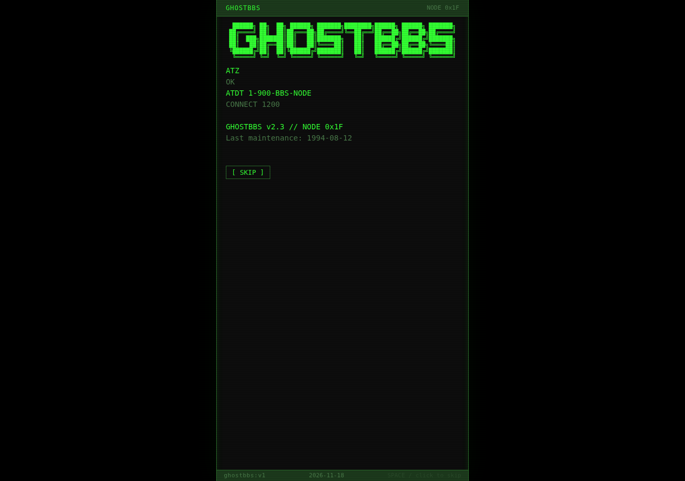
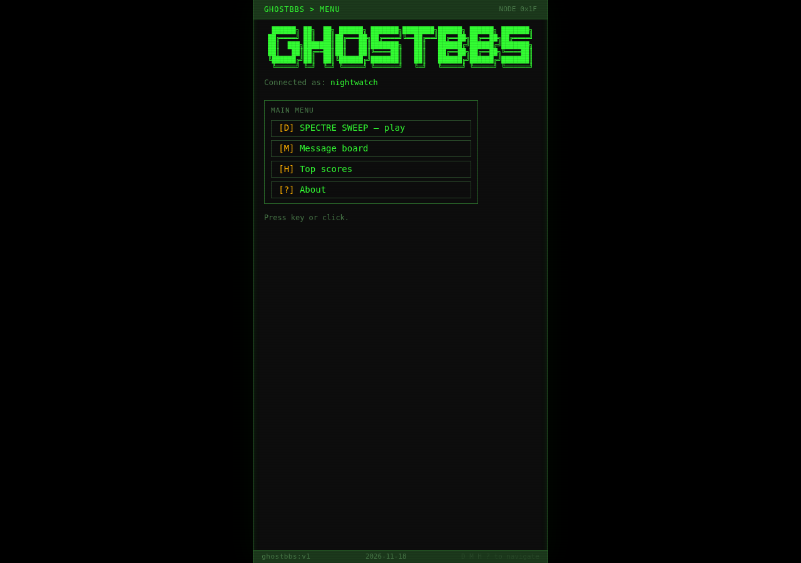
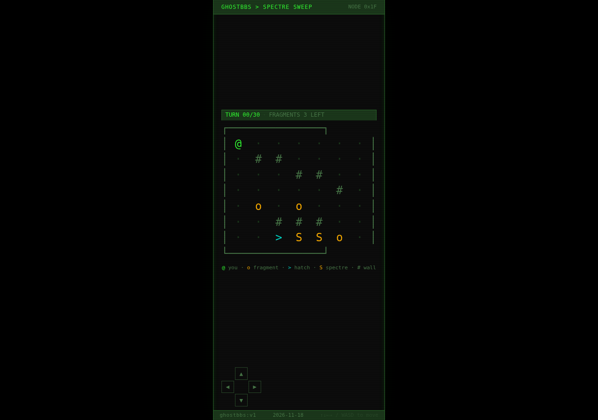
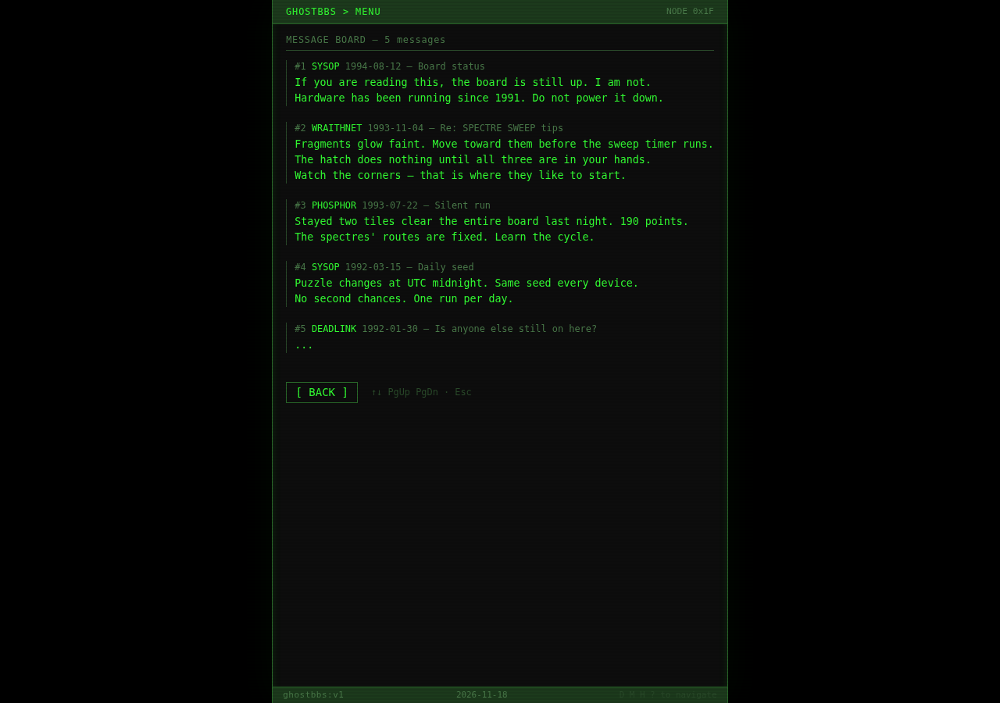
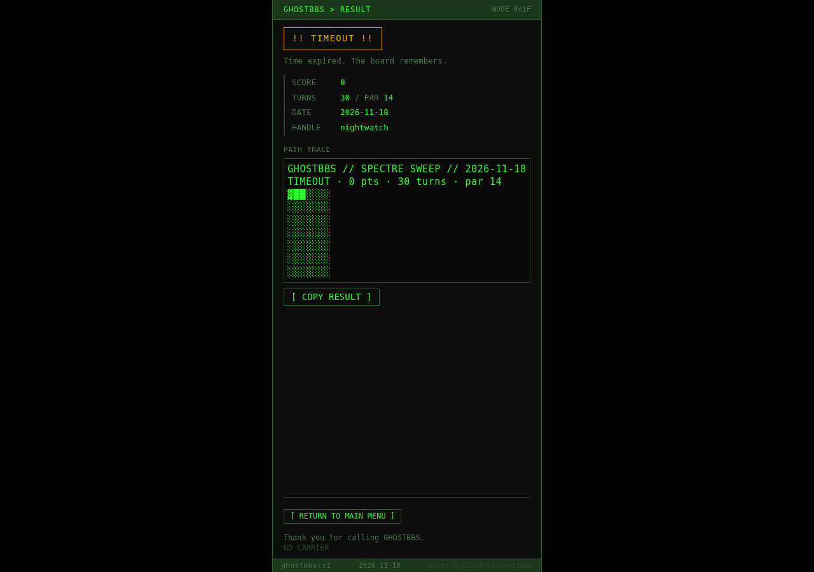
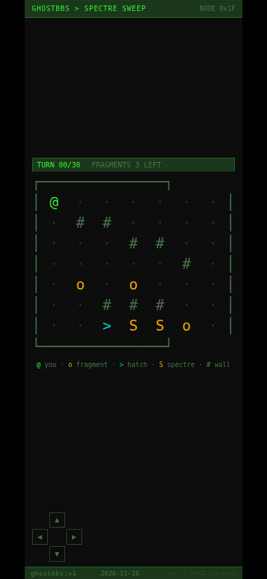

# GHOSTBBS

A resurrected 1980s bulletin board system you can actually dial into and play. GHOSTBBS is a static browser SPA — no backend, no network calls at runtime. Its fiction: a sysop's machine that was never powered down; the board still answers the phone at 1200 baud.

The only surviving door game is **SPECTRE SWEEP**: a daily 7×7 grid puzzle seeded from the UTC date. Collect three fragments, reach the hatch, avoid the spectres. One run per UTC day. Scores persist in `localStorage`. Nothing leaves your browser.

Status: playable, `npm test` → 57 passing, `npm run build` green. Built for the
Kiroween 2026 hackathon, Resurrection category.

---

## Screenshots

| Boot | Main menu | Door game |
|------|-----------|-----------|
|  |  |  |

| Message board | Result card | Mobile |
|----------|-------------|--------|
|  |  |  |

---

## Run / Build / Test

```sh
npm install          # install dependencies (first time only)
npm run dev          # local dev server at http://localhost:5173
npm run build        # production build → dist/
npm run preview      # preview the production build locally
npm test             # run Vitest unit tests
npx tsc --noEmit     # TypeScript type-check with no emit
```

The production build is a self-contained static site. Serve `dist/` from any CDN or file server; relative asset paths (`base: './'` in `vite.config.ts`) ensure it works from any subdirectory or via `file://`.

---

## Tech

| Layer | Choice |
|-------|--------|
| Build | Vite 7 |
| UI | React 19 + TypeScript 5 (strict) |
| Tests | Vitest 3 + fast-check 4 (property-based) |
| Styling | Single hand-authored CSS file, monospace-only font stack |
| State | React `useState` — no router, no state library |
| Persistence | `localStorage` via `src/game/storage.ts`, namespaced `ghostbbs:v1:*` |
| Randomness | mulberry32 PRNG seeded by `hash32("ghostbbs:" + YYYY-MM-DD)` |
| Solvability | BFS over `(cell, collectedMask)` state space; every generated level is verified before use; `FALLBACK_LEVEL` substituted on the rare unsolvable layout |
| Network | Zero runtime fetches; system fonts only |

No npm dependencies were added beyond those already in `package.json` (Vite, React, TypeScript, Vitest, fast-check).

---

## How Kiro was used

GHOSTBBS was built with the **Kiro CLI 3.5.0 on the free plan**, headless
(`kiro-cli chat --no-interactive --trust-all-tools --trust-workspace`), authenticated with
Google SSO. No API key, no paid credits, no card. The CLI ran inside a NixOS
`buildFHSEnv` sandbox because the bundled Node runtime needs an FHS root.

The repo scaffold was written by hand: `package.json`, `tsconfig.json`,
`vite.config.ts`, `index.html`, `LICENSE`, the three steering files and the hook. Every
line of `src/game/`, every React component and every test was generated by Kiro.

### Steering files

Three workspace-level steering documents (`.kiro/steering/`) were written before any
code and were loaded by the agent on every run:

- `product.md` — the fiction, the game rules and the definition of done.
- `tech.md` — stack, determinism, accessibility and the "no network" rule.
- `structure.md` — file layout, the DOM-free engine boundary and the 200-line split rule.

### Spec phase

Three spec files were generated in `.kiro/specs/ghostbbs/` by `--mode spec` runs:

- `requirements.md` — 15 numbered requirements with EARS-style acceptance criteria.
- `design.md` — module boundaries, types, the seeded level generator, BFS par,
  eight-step turn resolution, scoring, storage schema and a property-based test plan.
- `tasks.md` — 22 ordered tasks with file targets, verification commands and
  requirement traceability.

### Implementation

Tasks 1–9 (engine) and 11–19 (UI) were implemented in headless sessions that read the
spec first and verified with `npm run typecheck`, `npm test` and `npm run build`. Two
further sessions did visual QA against screenshots of the running build. The
`PostFileSave` hook (`.kiro/hooks/typecheck-on-save.json`) ran `tsc --noEmit` after every
file write and logged 40 receipts — including the type errors it caught — to
`.kiro/hook-log.txt`.

The free monthly allowance ran out during the final layout pass (the CLI returned
`UsageLimitReachedError`), so the last CSS alignment and the share-text header were
finished by hand. `docs/kiro-build-log.md` lists every prompt, its result and the honest
split between generated and hand-written work.

### Kiro configuration used

- **Steering:** `.kiro/steering/product.md`, `tech.md`, `structure.md`
- **Hooks:** `.kiro/hooks/typecheck-on-save.json` → `node scripts/post-save-check.mjs`
- **Spec:** `.kiro/specs/ghostbbs/requirements.md`, `design.md`, `tasks.md`
- **Model:** the free-tier default offered to CLI sessions
- **Logs:** `docs/kiro-runs/*.txt` (raw output), `docs/kiro-build-log.md` (prompts + credits)

---

## Reused code notice

The daily-seed idea, the `mulberry32` PRNG and the BFS-par approach were adapted from
our own MIT-licensed repository
[matrixneoaiagent/nullswarm-daily](https://github.com/matrixneoaiagent/nullswarm-daily).
The hash in `src/game/daily.ts` is a djb2 variant rather than that repo's FNV-1a, and
the board, rules, scoring, UI and tests are new for GHOSTBBS. Reuse is disclosed here as
the hackathon rules require; all code in this repository is MIT-licensed.

---

## Licence

MIT — see `LICENSE`.
